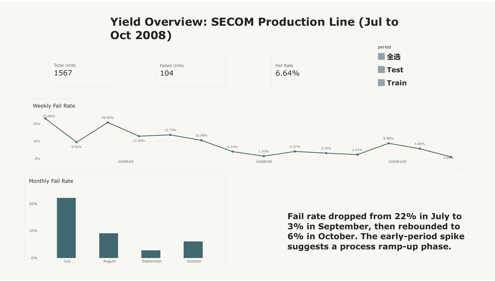
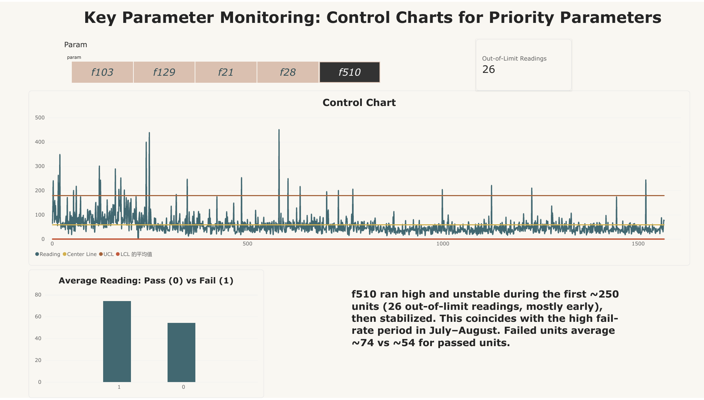
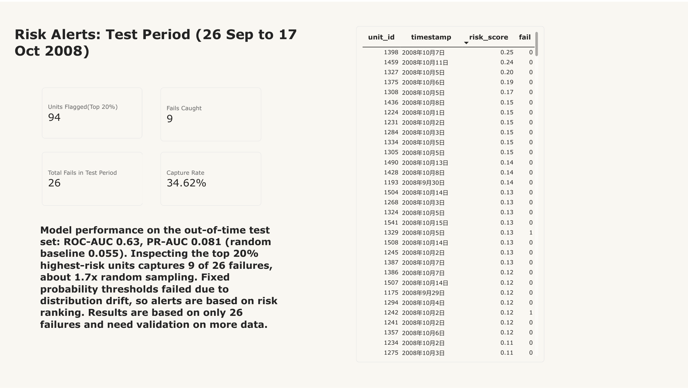

# SECOM Semiconductor Yield Analysis

Predicting pass/fail outcomes and identifying the process parameters most associated with failures, using sensor data from a semiconductor manufacturing line. Results are presented in a three-page Power BI dashboard.

**Tools:** Python (pandas, scikit-learn, SciPy), Power BI (Power Query, DAX)

---

## Key findings

1. **Two parameters are consistently linked to failures.** Parameters 103 and 510 are significantly higher in failed units in both the training period and the later, unseen test period. They are the recommended priority for process monitoring.
2. **The fail rate changed a lot over time.** It fell from 22% in July to 3% in September, then rose to 6% in October. Control charts show both priority parameters were higher and less stable during roughly the first 250 units, the same period as the highest fail rate.
3. **Prediction is only modestly better than random.** On the out-of-time test set the model reaches ROC-AUC 0.63. Inspecting the 20% highest-risk units finds 9 of 26 failures, about 1.7x what random sampling would find.
4. **The strongest training-period signal did not last.** Parameter 59 ranked first in the training period but showed no relationship with failures in the test period.

## Dashboard

| Yield Overview | Key Parameter Monitoring | Risk Alerts |
|---|---|---|
|  |  |  |

Full report: [SECOM Yield Monitoring Report.pdf](SECOM%20Yield%20Monitoring%20Report.pdf)

- **Yield Overview:** total units, failed units, fail rate, weekly and monthly fail-rate trends.
- **Key Parameter Monitoring:** control chart for each priority parameter with centre line and control limits, plus a pass vs fail comparison.
- **Risk Alerts:** highest-risk units in the test period and how many failures an inspection budget of the top 20% would capture.

## Data

[UCI SECOM dataset](https://archive.ics.uci.edu/dataset/179/secom) (CC BY 4.0).

| | |
|---|---|
| Units | 1,567 |
| Sensor features | 590 (anonymised) |
| Failed units | 104 (6.64%) |
| Period | 19 July 2008 to 17 October 2008 |

## Approach

### 1. Out-of-time split

Units were sorted by timestamp. The first 70% were used for training and the last 30% for testing, to imitate predicting future production from past data.

| Set | Period | Units | Fails | Fail rate |
|---|---|---|---|---|
| Train | 19 Jul to 26 Sep | 1,096 | 78 | 7.12% |
| Test | 26 Sep to 17 Oct | 471 | 26 | 5.52% |

### 2. Cleaning (rules learned from the training set only)

| Step | Features removed |
|---|---|
| Constant features | 122 |
| More than 50% missing | 24 |
| Missingness confounded with time (see below) | 4 |
| Highly correlated, absolute r above 0.95 | 172 |
| **Remaining** | **268** |

Remaining missing values were filled with training-set medians.

### 3. Is missingness itself a signal?

Four features (72, 73, 345, 346) are missing on exactly the same units. Units with these readings missing had a fail rate of 4.5%, against 8.8% when present (chi-square p = 0.001).

However, the share of missing readings rose from 16% in July to 67% in October while the fail rate fell. Within each month the gap narrows, and in October it reverses. The difference is therefore mostly explained by time, so these features and a missing-value flag were left out of the baseline model.

### 4. Modelling

- **Baseline at the default 0.5 threshold:** logistic regression and random forest both caught 0 of 26 failures. Accuracy was 94.5% for a model that predicts "pass" for everything, which is why accuracy was not used.
- **Model selection:** 4-fold time-series cross-validation on the training set. Random forest with the 100 highest-scoring features (ANOVA F-test) performed best, with mean PR-AUC 0.253 (fold range 0.12 to 0.41). Logistic regression stayed near 0.09.
- **Threshold:** the F1-optimal threshold from out-of-fold predictions was 0.203.

### 5. Test-set results

| Metric | Result | Random baseline |
|---|---|---|
| ROC-AUC | 0.632 | 0.5 |
| PR-AUC | 0.081 | 0.055 |
| Failures caught at threshold 0.203 | 0 of 26 (3 false alarms) | |

The threshold failed because predicted probabilities shifted downward in the test period: the median predicted probability for failed units fell from 0.161 in validation to 0.074 in test. Alerts were therefore evaluated by risk ranking instead of a fixed threshold.

| Inspection budget | Units inspected | Failures found | Expected from random sampling |
|---|---|---|---|
| Top 5% | 23 | 1 | 1.3 |
| Top 10% | 47 | 3 | 2.6 |
| Top 20% | 94 | 9 | 5.2 |

### 6. Which parameters are linked to failures?

Each feature was tested with a Mann-Whitney U test on the training set. 51 features had p < 0.05; 17 remained after Benjamini-Hochberg correction. Candidates were then checked for model importance and for a consistent effect in the test period.

| Tier | Parameter | Effect size (train) | Effect size (test) | Test p-value |
|---|---|---|---|---|
| 1: strong and stable | 103 | 0.46 | 1.12 | 0.0002 |
| 1: strong and stable | 510 | 0.43 | 0.99 | 0.0037 |
| 2: consistent direction | 129 | 0.43 | 0.33 | 0.054 |
| 2: consistent direction | 21 | 0.48 | 0.28 | 0.17 |
| 2: consistent direction | 28 | -0.45 | -0.29 | 0.21 |
| Not stable | 59 | 0.71 | -0.07 | 0.64 |

Effect size is the standardised difference in means between failed and passed units. Control limits on the dashboard are the mean plus or minus three standard deviations of passing units in the training period. The lower limit for parameter 510 is set to 0 because its readings are right-skewed and never negative.

## Limitations

- The test set contains only 26 failures, so every metric has wide uncertainty.
- Features are anonymised, so findings cannot be tied to a specific process step. The ramp-up explanation for the early fail rate is a hypothesis that would need engineering records to confirm.
- The process drifted over the three months. A deployed model would need regular retraining and monitoring.
- The ranking-based evaluation was introduced after the fixed threshold failed on the test set, so it should be confirmed on new data.

## Repository structure

```
secom-yield-prediction/
├── 01_data_overview.ipynb      # first look, missing values, time trends
├── 02_split_and_clean.ipynb    # out-of-time split and cleaning
├── 03_modeling.ipynb           # models, evaluation, parameter analysis, dashboard export
├── dashboard/                  # dashboard data and screenshots
├── processed/                  # cleaned train and test sets
├── raw/                        # original UCI files
└── requirements.txt
```

## How to run

```bash
pip install -r requirements.txt
jupyter notebook
```

Run the notebooks in order (01, 02, 03).
